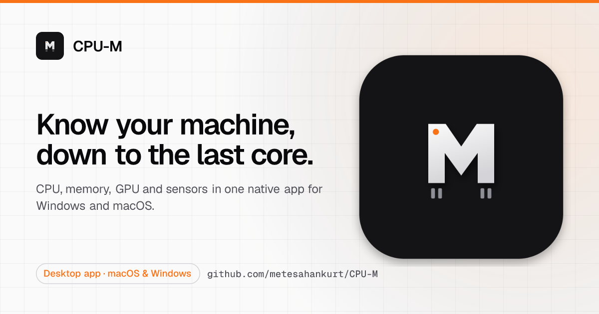

<div align="center">
  
  <h1>CPU-M</h1>
  <p><strong>Know your machine, down to the last core.</strong></p>
  <p>Detailed Windows and macOS system information, in a native app built with Tauri, React and TypeScript.</p>
  <p>
    <a href="https://github.com/metesahankurt/CPU-M/releases/latest">Download</a> ·
    <a href="#development">Development</a> ·
    <a href="#releases-and-auto-updates">Releases</a>
  </p>
</div>

---

## Development

| Command | Does |
| --- | --- |
| `pnpm build` | Builds the web front end |
| `cargo test --manifest-path src-tauri/Cargo.toml` | Runs the Rust tests |
| `cargo clippy --manifest-path src-tauri/Cargo.toml --all-targets -- -D warnings` | Lints the Rust code, warnings as errors |
| `pnpm tauri build` | Builds the desktop bundles |

## Releases and auto updates

The app uses the Tauri v2 updater and checks GitHub Releases at:

```
https://github.com/metesahankurt/CPU-M/releases/latest/download/latest.json
```

For fully automatic releases, add these GitHub repository secrets once:

| Secret | Value |
| --- | --- |
| `TAURI_SIGNING_PRIVATE_KEY` | The content of the private updater key |
| `TAURI_SIGNING_PRIVATE_KEY_PASSWORD` | Empty for the current generated key, or the key password if you regenerate it with one |

The local private key generated during setup is stored at `~/.tauri/cpu-m-updater.key`; keep it
secret. Copy the file's content into the GitHub secret, not the local file path:

```sh
pbcopy < ~/.tauri/cpu-m-updater.key
```

Once the secrets are configured, each push to `master` or `main`:

1. bumps the patch version and commits `chore(release): vX.Y.Z`,
2. tags it and builds the macOS and Windows bundles,
3. uploads a GitHub Release with `latest.json` attached.

Installed apps detect the new release, download and install it, and relaunch automatically.
Manual tag releases are still supported through the `Release` workflow.

## Brand

<picture>
  <source media="(prefers-color-scheme: dark)" srcset="brand-kit/social/og-dark.png">
  
</picture>

The mark is a solid M standing on chip pins, pin 1 marked in orange. The app icons in
`src-tauri/icons/` (macOS `.icns` on Apple's grid, Windows `.ico`, Store logos) and the window
favicon in `public/favicon.svg` are rendered from it; sources and variants live in
[`brand-kit/`](brand-kit/README.md).
